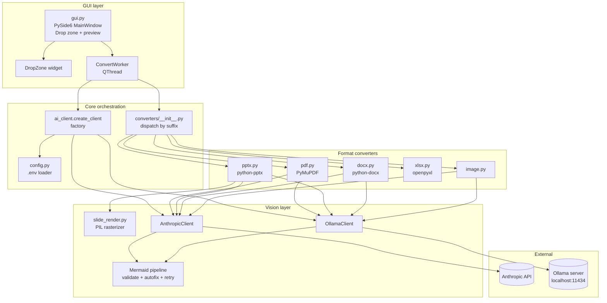
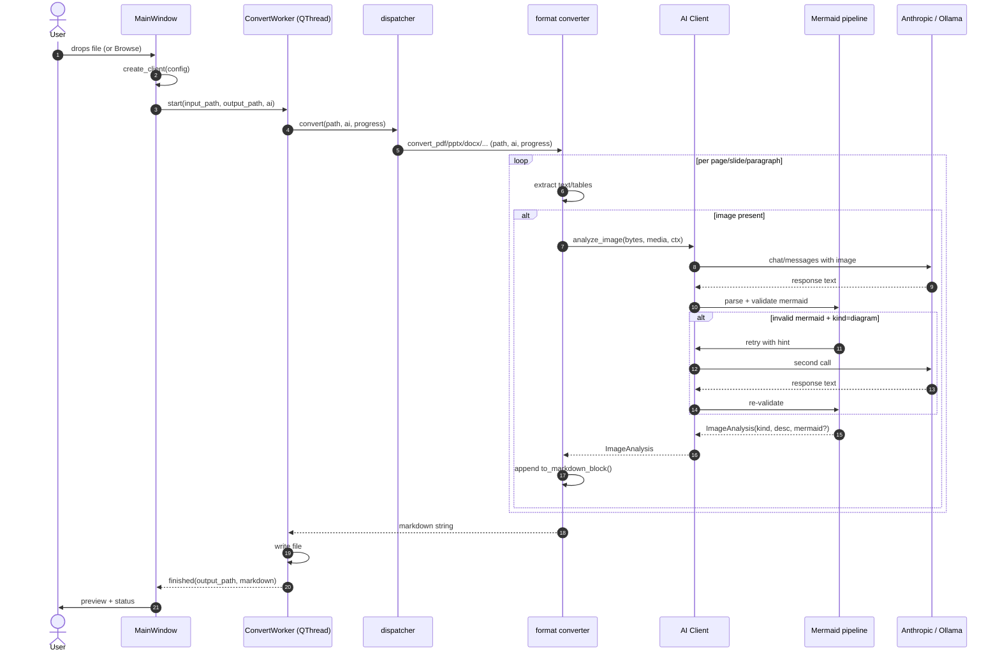
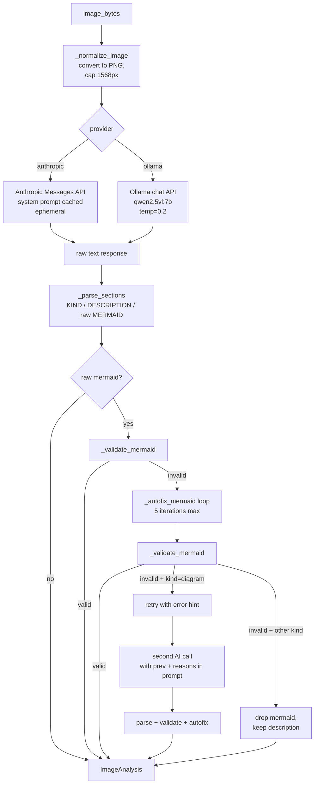
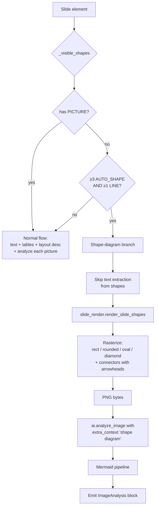
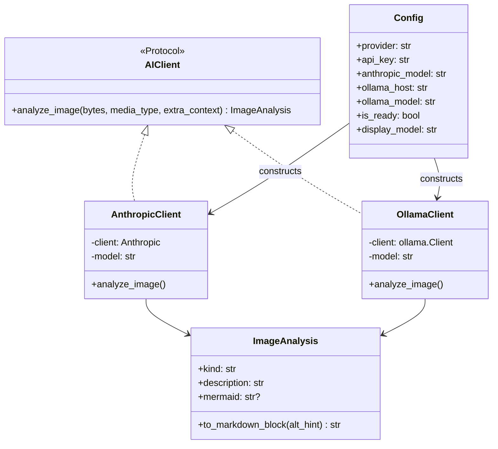

# Architecture

## Component overview



## Module responsibilities

| Module                            | Responsibility |
|-----------------------------------|----------------|
| `anytomd/__main__.py`             | Entry point; invokes `gui.run()`. |
| `anytomd/gui.py`                  | PySide6 UI. `MainWindow`, `DropZone`, `ConvertWorker`. Runs conversion off the UI thread. |
| `anytomd/config.py`               | Loads `.env` from project root (so shortcut launches work), exposes `Config` dataclass with provider + credentials. |
| `anytomd/ai_client.py`            | `AnthropicClient`, `OllamaClient`, factory, `ImageAnalysis` result type, Mermaid validate/autofix/retry pipeline. |
| `anytomd/slide_render.py`         | PIL rasterizer for PPTX native shapes (rectangle, rounded, oval, diamond, connector). |
| `anytomd/converters/__init__.py`  | Dispatcher: extension → `convert_*` function. |
| `anytomd/converters/pdf.py`       | PyMuPDF text extraction, header/footer heuristic, image extraction. |
| `anytomd/converters/pptx.py`      | Slide walk; text/table/layout emission; shape-diagram branch. |
| `anytomd/converters/docx.py`      | Body walk (paragraphs + tables interleaved); heading/list detection; inline image extraction. |
| `anytomd/converters/xlsx.py`      | Sheet iteration; cell rendering; trim + cap. |
| `anytomd/converters/image.py`     | Single-image AI call. |

## Data flow — a typical run



## Vision pipeline

Same for both providers. The only difference is transport: Anthropic uses base64+system-prompt-with-cache; Ollama uses raw bytes in the `images` field of `chat`.



## Mermaid quality pipeline

Purpose: hide inconsistency of VLM Mermaid syntax so the `.md` renders without errors. Description is always preserved; only the Mermaid block can be dropped.

### Bad-pattern regex (`ai_client._MERMAID_BAD_PATTERNS`)

Ordered list — validator returns first failure reason:

| Pattern | Rejects |
|---------|---------|
| `\w+\s+\[.+\]\s*(-->|--)` | `A [label] -->` — space between id and `[label]` |
| `\w+\s+\{.+\}\s*(-->|--)` | `A {label} -->` |
| `\w+\s+\(.+\)\s*(-->|--)` | `A (label) -->` |
| `(?<![\[\{\(|\w])\w+\?` | `Pass?` as bare identifier (allowed only inside `[]`, `{}`, `()`, or `|...|`) |
| `(?:-->|---)\s*\w+\s+\[` | `--> B [label]` — space between target id and its label |

Also fails if the first line doesn't start with a known Mermaid diagram type (`flowchart`, `graph`, `sequenceDiagram`, `classDiagram`, `stateDiagram`, `erDiagram`, `gantt`, `mindmap`, `journey`, `pie`, `gitGraph`, `timeline`, `quadrantChart`, `requirementDiagram`, `C4Context`, `block-beta`, `architecture-beta`).

### Autofix loop (`ai_client._autofix_mermaid`)

Runs to a fixed point (max 5 iterations) in this order per iteration:

1. **Strip bare `?`** from identifiers not inside brackets: `Pass?` → `Pass`.
2. **Label-before-arrow**: `X [label] -->` → `X -->|label|`.
3. **Label-after-arrow-target**: `--> X [label]` → `-->|label| X`.

The `?` strip runs first because otherwise it blocks rules 2/3 (their regex requires plain `\w*` on either side, which `?` isn't).

### Retry policy

Fires only when:
- `kind == "diagram"` (AI thinks the image IS a diagram, so we owe the user Mermaid)
- Raw Mermaid was produced and non-`NONE`
- Post-autofix mermaid is still `None`

Retry sends a second AI call with the same image plus an appended context containing (a) the previous invalid Mermaid verbatim and (b) the specific failure reasons. Model given one more shot. If it still fails, description-only is emitted.

Retry doubles latency for failed cases only. On our smoke fixtures with Ollama, most diagrams autofix without retry.

## PPTX shape-diagram flow (unique to this format)



Text extraction is intentionally skipped in the shape-diagram branch because otherwise the shape labels ("Commit", "Build", ...) would appear twice: once as bullet-style paragraphs from the text-frame walk, and again as part of the AI's diagram description. See [DECISIONS.md § shape-diagram dedup](DECISIONS.md#pptx-shape-diagram-dedup).

## GUI threading model

```mermaid
sequenceDiagram
    participant UI as Qt main thread
    participant WT as QThread
    participant CV as convert()

    UI->>UI: user drops file
    UI->>UI: create AI client (may fail here → dialog)
    UI->>WT: moveToThread(worker); start()
    WT->>CV: convert(path, ai, progress=callback)
    loop per page/slide
        CV-->>UI: progress signal (queued connection)
        UI->>UI: update status label
    end
    alt success
        CV-->>WT: markdown string
        WT-->>UI: finished signal (output_path, markdown)
        UI->>UI: preview + enable Save-as
    else failure
        CV--xWT: exception
        WT-->>UI: failed signal (traceback)
        UI->>UI: error dialog
    end
    WT->>WT: quit()
    UI->>UI: teardown worker
```

Only one conversion at a time — the UI prevents starting a second while one is in progress. Progress messages are pushed via a Qt signal from the worker thread; they're queued to the UI thread (default `Qt::QueuedConnection` across threads).

## Provider factory



`create_client(config)` picks the concrete class based on `config.provider`. Because `AIClient` is a `typing.Protocol`, converters take it structurally — no import cycles.

## Non-obvious cross-cutting behaviors

- **All image bytes are normalized to PNG** and downsized to max 1568px on the longest side before sending to any provider. Reduces both API cost and inference time; avoids format-support mismatch.
- **System prompt is cached (Anthropic)** via `cache_control: ephemeral` so a 4-image PDF pays the prompt cost once, not four times.
- **`.env` is loaded from project root**, not CWD. `config.py` computes `Path(__file__).parent.parent / ".env"`. This lets the app work when launched from a Start Menu shortcut whose working directory isn't the project.
- **Progress messages are user-facing strings in Bahasa Indonesia** (`"Page 1/3: teks"`, `"Slide 3: gambar 1/1"`). Not localized because the whole app is single-locale.
