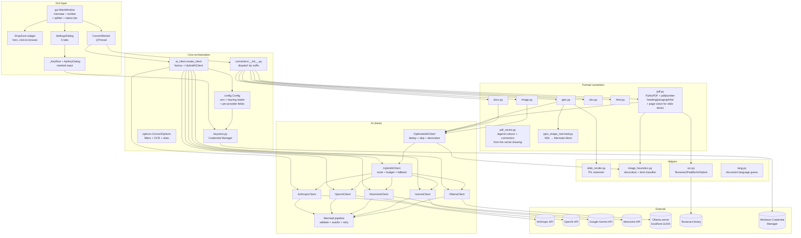
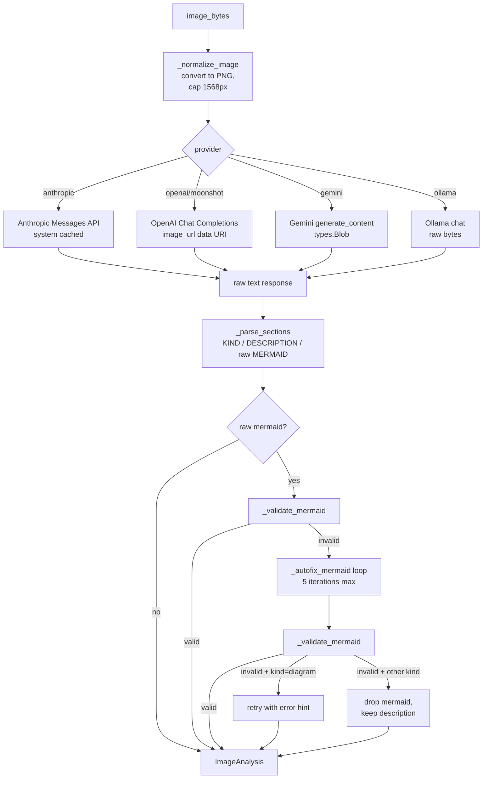
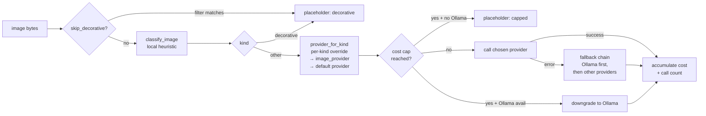
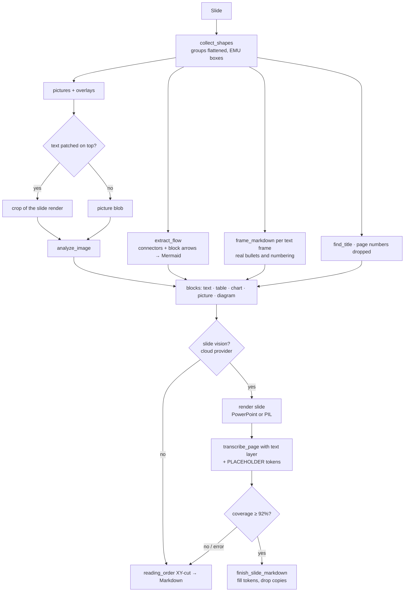
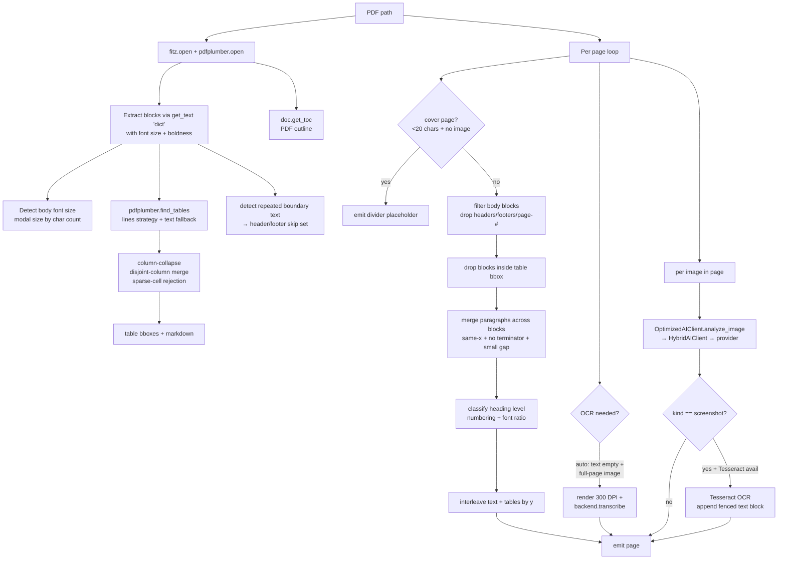
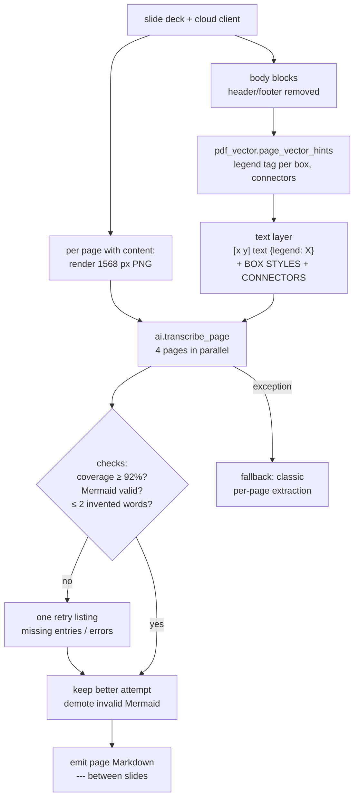
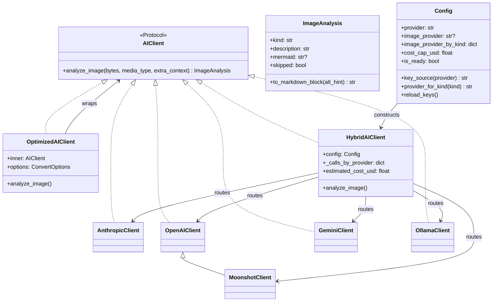

# Architecture

## Component overview



## Module responsibilities

| Module                                    | Responsibility |
|-------------------------------------------|----------------|
| `anytomd/__main__.py`                     | Entry point; invokes `gui.run()`. |
| `anytomd/gui.py`                          | PySide6 UI: `MainWindow` (menubar + toolbar + hero + splitter + status bar), `SettingsDialog` (5 tabs), `ProviderPanel` (currently unused in main; retained for possible future embed), `ApiKeyDialog`, `_KeyRow`, `ConvertWorker`, `OptionsPanel`. Global QSS at module top. |
| `anytomd/config.py`                       | Loads `.env` from project root, then keyring, then env vars. Exposes `Config` dataclass with per-provider fields (Anthropic, OpenAI, Gemini, Moonshot, Ollama). `provider_for_kind()` implements hybrid routing lookup. `key_source()` returns `"env"`/`"keyring"`/`"missing"` for GUI display. `cost_per_call()` returns cost estimate per provider. |
| `anytomd/keystore.py`                     | Thin `keyring` wrapper: `get_key/set_key/delete_key/backend_name`. Uses OS-native store (Windows Credential Manager on Windows via DPAPI). Graceful degradation if no backend. |
| `anytomd/ai_client.py`                    | 5 provider clients: `AnthropicClient`, `OpenAIClient`, `MoonshotClient(OpenAIClient)`, `GeminiClient`, `OllamaClient`, each with `analyze_image` (describe) and `transcribe_page` (page vision) over one `_complete(png, system, user_text, max_tokens)`; `is_local` marks Ollama. `HybridAIClient` classifies per image (local heuristic) → routes → tracks cost per provider → falls back on error; page vision follows the *diagram* route. `OptimizedAIClient` wraps for dedup + skip-tiny + decorative filter + full-skip mode; filtered results are `silent`. Mermaid parse/validate/autofix/retry pipeline shared by all providers. Page vision: `PAGE_SYSTEM` prompt, `format_text_layer_entry`, `page_coverage`, `added_words`, `_transcribe_page_with_retry`. |
| `anytomd/options.py`                      | `ConvertOptions` dataclass: image filters, decorative skip, OCR mode/engine/lang, `pdf_page_vision`, `pptx_slide_vision`. `_stats` dict accumulates counters + est_cost_usd + page-vision coverage/tokens for GUI status bar. |
| `anytomd/lang.py`                         | `detect_language(text)` — English / Bahasa Indonesia by stopword counts, Arabic by script share. Used to ask for image descriptions in the document's language. |
| `anytomd/image_heuristics.py`             | Zero-cost local classifiers: `is_decorative()` (solid blobs), `looks_like_diagram()` (diagram-only prefilter), `classify_image()` (returns `decorative`/`photo`/`chart`/`screenshot`/`diagram`/`unknown` for hybrid routing). |
| `anytomd/slide_render.py`                 | PIL rasterizer for PPTX native shapes — fallback when direct XML extraction can't recover the graph. |
| `anytomd/ocr.py`                          | 4 OCR backends: Tesseract, PaddleOCR (optional heavy), AI Vision (reuses provider), Hybrid (Tesseract → AI fallback). |
| `anytomd/converters/__init__.py`          | Dispatcher: extension → `convert_*` function. Wraps `ai` with `OptimizedAIClient` per-conversion. |
| `anytomd/converters/pdf.py`               | PyMuPDF `get_text("dict")` for spans+fonts. pdfplumber tables with column-collapse + disjoint-merge + text-strategy fallback (whole-word cells via `_table_from_words` when the bbox cuts words). Heading detection via font-size clustering + numbering regex. Paragraph merge across blocks. Nested bullets from x-indent. Cover-page skip. PDF outline passthrough. Painted-only images (`_drawn_images`), template-image skip, images placed by y. Screenshot OCR via `_ocr_screenshot_if_possible`. Slide-deck detection (`_is_slide_deck`) and page vision (`_use_page_vision`, `_run_page_vision`: render + text layer + vector hints, 4 pages in parallel, per-page fallback). |
| `anytomd/converters/pdf_vector.py`        | Reads the page's vector drawing for page vision: boxes (style = border colour, fill, dashed), legend swatches with their labels, connectors with arrowheads and badge labels. Returns per-text-block tags (`{legend: X}` / `{box Sn}`) and a BOX STYLES + CONNECTORS appendix. |
| `anytomd/converters/pptx.py`              | Orchestrator (reworked 2026-09-30). `_prepare` builds each slide's blocks from the XML (title, paragraphs, tables, charts, pictures with their overlays, flowchart); `_analyze_pictures` (alt text, decorative/icon skip, crop of the render when text is patched on top, AI); deterministic output via `reading_order`; slide vision (`_use_slide_vision`, `slide_text_layer` with `[[PICTURE n]]`-style placeholders, `_run_slide_vision` 4 in parallel, `finish_slide_markdown` fills placeholders / drops model copies / adds `##`; coverage < 92% or error → deterministic). Speaker notes, native charts. |
| `anytomd/converters/pptx_shapes.py`       | `collect_shapes(slide)` → `ShapeInfo` per shape: groups flattened with their transforms applied, box in slide EMU, `cNvPr` id, drawing order, kind, placeholder role, connector ends. `clean_text` turns soft breaks into spaces. |
| `anytomd/converters/pptx_layout.py`       | Deterministic layout: `find_title` (placeholder or largest top text), `is_page_number`, `frame_markdown` (real bullets/numbering from `buAutoNum`/`buChar`/hand-typed numbers, depth from `marL+indent`, continuations, bold paragraphs), `table_markdown`, `find_overlays`, `reading_order` (XY-cut). |
| `anytomd/converters/pptx_shape_mermaid.py`| `extract_flow` / `resolve_edges`: connectors resolved via `stCxn`/`endCxn` or box hit (text boxes count as nodes), arrowheads for direction, block arrows, midpoint labels → `Flow` with `mermaid()` and `hint_lines()`. `try_extract_mermaid` kept as a wrapper. |
| `anytomd/pptx_render.py`                  | Slide images: `render_with_powerpoint` (COM via PowerShell, read-only, all slides in one session), `render_with_pil` (fills, borders, pictures, wrapped text, connectors, block arrows), `crop_box`. `ANYTOMD_PPTX_RENDERER`. |
| `anytomd/converters/docx.py`              | python-docx body walk (paragraphs + tables interleaved); heading/list detection; inline image extraction. |
| `anytomd/converters/xlsx.py`              | openpyxl sheet iteration; cell rendering; trim + cap. |
| `anytomd/converters/html.py`              | beautifulsoup4 + markdownify. Strips `<script>/<style>/<nav>/<footer>/<aside>`; drops anchors on link-heavy pages. |
| `anytomd/converters/image.py`             | Single-image AI call. |

## Data flow — a typical run

```mermaid
sequenceDiagram
    autonumber
    actor User
    participant GUI as MainWindow
    participant W as ConvertWorker (QThread)
    participant D as dispatcher
    participant C as format converter
    participant OPT as OptimizedAIClient
    participant H as HybridAIClient
    participant CL as concrete client (any of 5)
    participant P as Mermaid pipeline
    participant Ext as Anthropic / OpenAI / Gemini / Moonshot / Ollama

    User->>GUI: drops file (or Ctrl+O)
    GUI->>GUI: create_client(config)<br/>→ HybridAIClient if hybrid config,<br/>else concrete client
    GUI->>W: start(input_path, output_path, ai, options)
    W->>D: convert(path, ai, progress, options)
    D->>D: wrap ai in OptimizedAIClient (if opts)
    D->>C: convert_pdf/pptx/docx/... (path, ai, progress, options)
    loop per page/slide/paragraph
        C->>C: extract text/tables/native chart data
        alt image present
            C->>OPT: analyze_image(bytes, media, ctx)
            OPT->>OPT: dedup by SHA-256?<br/>skip tiny? decorative?
            OPT->>H: (if hybrid) analyze_image
            H->>H: classify_image (local)<br/>→ pick provider by kind
            H->>CL: analyze_image on chosen provider
            CL->>Ext: API call with image
            Ext-->>CL: response text
            CL->>P: parse + validate mermaid
            P-->>CL: ImageAnalysis
            CL-->>H: ImageAnalysis
            H->>H: accumulate cost + call count
            H-->>OPT: ImageAnalysis
            OPT-->>C: ImageAnalysis
            C->>C: append to_markdown_block()
        end
    end
    C-->>W: markdown string
    W->>W: write file
    W-->>GUI: finished(output_path, markdown, stats)
    GUI->>User: preview + status bar + cost label
```

## Vision pipeline

Same for all 5 providers. Only the transport differs:

- **Anthropic**: `messages.create` with `image` block + base64 data; system prompt cached via `cache_control: ephemeral`.
- **OpenAI / Moonshot**: `chat.completions.create` with `image_url` data URI (`data:image/png;base64,...`). Moonshot swaps `base_url` to `api.moonshot.cn/v1`.
- **Gemini**: `models.generate_content` with `types.Blob(mime_type="image/png", data=bytes)`; system prompt via `GenerateContentConfig(system_instruction=...)`.
- **Ollama**: `chat` with `images=[png_bytes]` in the user message.



## Hybrid AI routing



## Mermaid quality pipeline

Purpose: hide inconsistency of VLM Mermaid syntax so the `.md` renders without errors. Description is always preserved; only the Mermaid block can be dropped.

### Bad-pattern regex (`ai_client._MERMAID_BAD_PATTERNS`)

Ordered list — validator returns first failure reason:

| Pattern | Rejects |
|---------|---------|
| `\w+\s+\[.+\]\s*(-->|--)` | `A [label] -->` — space between id and `[label]` |
| `\w+\s+\{.+\}\s*(-->|--)` | `A {label} -->` |
| `\w+\s+\(.+\)\s*(-->|--)` | `A (label) -->` |
| `(?<![\[\{\(|\w])\w+\?` | `Pass?` as bare identifier (allowed only inside `[]`, `{}`, `()`, or `|...|`) |
| `(?:-->|---)\s*\w+\s+\[` | `--> B [label]` — space between target id and its label |

Also fails if the first line doesn't start with a known Mermaid diagram type.

### Autofix loop (`ai_client._autofix_mermaid`)

Runs to a fixed point (max 5 iterations) in this order per iteration:

1. **Strip bare `?`** from identifiers not inside brackets: `Pass?` → `Pass`.
2. **Label-before-arrow**: `X [label] -->` → `X -->|label|`.
3. **Label-after-arrow-target**: `--> X [label]` → `-->|label| X`.

### Retry policy

Fires only when `kind == "diagram"`, raw Mermaid was non-`NONE`, and post-autofix mermaid is still `None`. Retry sends a second AI call with the previous invalid Mermaid + failure reasons appended to context.

## PPTX pipeline (2026-09-30)



The pieces that carry content — text, tables, charts, flowchart, transcribed pictures — are always taken from the file; slide vision only decides structure (headings, panels, reading order). A shape diagram whose connectors resolve to nothing still goes through the old raster + VLM pass (`slide_render.render_slide_shapes`).

## PDF pipeline (post-Sprint 1-2 refactor)



### Page vision (slide decks, 2026-09-27)

Decided once per document by `_use_page_vision` (mode `auto`: slide deck + non-local client + `image_mode != none`; `always`; `never`). Pages it transcribes skip the per-page loop above; the rest (empty pages, API failures) go through it unchanged.



## GUI structure

```mermaid
flowchart TB
    MW[MainWindow] --> MB[QMenuBar<br/>File · Settings · Help]
    MW --> TB[QToolBar<br/>Open · Save · Provider · Settings]
    MW --> SP[QSplitter vertical]
    SP --> WS[Workspace<br/>drop zone + options row]
    SP --> PV[Preview area<br/>QPlainTextEdit + Copy btn]
    MW --> SB[QStatusBar<br/>status · progress · cost]
    WS --> DZ[DropZone<br/>hero, dashed border,<br/>click-to-browse]
    WS --> OP[OptionsPanel<br/>Filter gambar | OCR ]
    TB --> PD[Provider dropdown<br/>Anthropic/OpenAI/Gemini/<br/>Moonshot/Ollama]
    MW -.-> SD[SettingsDialog<br/>modal, 5 tabs]
    SD --> T1[🔐 API Keys<br/>KeyRow + ApiKeyDialog]
    SD --> T2[🎯 Hybrid routing<br/>per-kind combos]
    SD --> T3[🔧 Model & endpoint<br/>lineedit per provider]
    SD --> T4[⚙ Advanced<br/>cost cap spinbox]
    SD --> T5[ℹ Info<br/>threat model]
    T1 --> KS[keystore.py<br/>Windows Cred Manager]
```

Only one conversion at a time — the UI prevents starting a second while one is in progress. Progress messages are pushed via a Qt signal from the worker thread; they're queued to the UI thread. Settings changes propagate via `settings_changed` signal → `Config.reload_keys()` → status bar refresh.

## Provider factory



`create_client(config)` returns `HybridAIClient` when hybrid routing is configured (any `image_provider*` set), else the concrete client for `config.provider`. Because `AIClient` is a `typing.Protocol`, converters take it structurally — no import cycles.

## Non-obvious cross-cutting behaviors

- **All image bytes are normalized to PNG** and downsized to max 1568px on the longest side before sending to any provider.
- **System prompt is cached (Anthropic only)** via `cache_control: ephemeral` — a 4-image PDF pays the prompt cost once, not four times.
- **`.env` is loaded from project root**, not CWD. `config.py` computes `Path(__file__).parent.parent / ".env"`. Lets the app work when launched from a Start Menu shortcut.
- **Progress messages are user-facing strings in Bahasa Indonesia** (`"Page 1/3: teks"`, `"Slide 3: gambar 1/1"`). Not localized because the whole app is single-locale.
- **Deferred imports for cloud SDKs** — `openai`, `google-genai` imported only inside their respective client constructors. App runs even if SDK missing for a provider you're not using.
- **Key precedence for readers**: env var (shell or `.env`) → keyring → empty. The GUI shows this via `📄 dari environment` / `🔑 tersimpan (keyring)` / `❌ belum ada` per row in Settings → API Keys.
- **Budget cap is soft** — hits are downgraded to Ollama (if available) rather than aborting. Only hard-stops when no free option exists.
